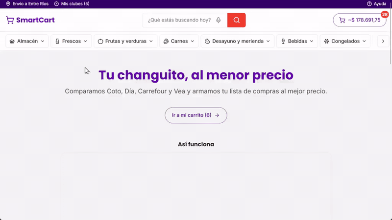
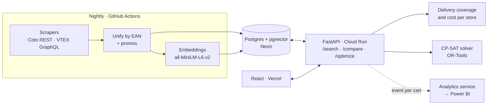

# SmartCart

**Live demo: [smart-cart-rouge.vercel.app](https://smart-cart-rouge.vercel.app)**

SmartCart tells you what your whole grocery cart costs at each supermarket in
Argentina. Every night it scrapes **Coto, Día, Carrefour, Vea, ChangoMás and Jumbo**
and unifies their catalogs by barcode (EAN). For a cart, it prices every chain
with promotions, bank discounts and delivery, swapping what a chain doesn't sell
for its closest equivalent there. When splitting the cart across chains saves
enough, a constraint solver (OR-Tools CP-SAT) offers the cheapest split, counting
each store's minimum purchase.

**⚠️ While scraping, it uncovered a card skimmer in Jumbo, Disco and Vea's online stores. You can read about it [here](https://www.brodersendarknews.com/p/disco-jumbo-y-vea-un-estudiante-de)**

| | |
|---|---|
| Chains | Coto, Día, Carrefour, Vea, ChangoMás, Jumbo — the same 85 shelves in each (79 to 85 depending on the chain) |
| Refresh | Nightly, GitHub Actions |
| Tests | 540+ (pytest) |
| Infra | API on Cloud Run, Postgres + pgvector on Neon, frontend on Vercel — all free tiers |

<p align="center">
  
  <br><sub>Browse or search, build the cart, and see what it costs at each chain (recorded before the per-store comparison became the main view).</sub>
</p>

## Architecture



## How it works

1. **Scraping.** Each chain's internal API: a REST BFF at Coto, VTEX GraphQL at
   the other five. Every chain sweeps the same shelves, because prices are only
   comparable over the same aisle.
2. **Unification.** The EAN is the identity (`prod_<ean>`): one row per product,
   one offer per chain.
3. **Search.** Products are embedded with `all-MiniLM-L6-v2` and queried through
   pgvector, so "gaseosa cola" finds Coca-Cola.
4. **Comparison.** The whole cart at each chain. A product a chain doesn't sell
   is replaced by the most similar one on the same shelf that shares its
   attributes (lactose-free stays lactose-free); with no acceptable replacement,
   it is priced at the most expensive other chain, so the chain missing the most
   never looks cheapest. Bank discounts vary by weekday, so each chain also
   reports its cheapest day of the week.
5. **Split (opt-in).** CP-SAT minimizes subtotal + delivery − bank discount, with
   each store's minimum purchase as a hard constraint. It is only offered when it
   saves a lot against the cheapest complete chain: every extra store is another
   checkout.

## Tech stack

- **Backend:** Python, FastAPI, PostgreSQL + pgvector, OR-Tools, sentence-transformers
- **Frontend:** React, Vite, Tailwind CSS, Leaflet
- **Infra:** GitHub Actions, Google Cloud Run, Neon, Vercel

## Running it locally

```bash
docker-compose up -d                  # Postgres + pgvector on localhost:5432
cp .env.example .env                  # Copy-Item in PowerShell; defaults work locally
pip install -r requirements.txt
python -m src.scripts.run_scrapers --store dia   # ~45 min; all six chains take ~6 h
uvicorn src.api:app --reload          # API on :8000, docs at /docs
cd frontend && npm install && npm run dev        # app on :5173
```

- The schema creates itself (`src/schema.py`); there are no migrations.
- **Search only finds products with an embedding.** The scraper script generates
  them at the end; if you stop it early, run it again.
- The frontend reads `VITE_API_URL` (`frontend/.env`, default
  `http://localhost:8000`) at build time.

There is no sample dump: a sweep rebuilds the whole catalog. For read-only access
to the production database, ask.

## Tests

```bash
pytest -m "not catalogo"   # what CI runs: no populated database or model needed
pytest                     # everything; needs Postgres populated and downloads the model
```

## Documentation (in Spanish)

- [`docs/arquitectura.md`](docs/arquitectura.md): how it's built, stage by stage.
- [`docs/operacion.md`](docs/operacion.md): where it runs, how to deploy, which limits to watch.
- [Issues](https://github.com/aviollaz/SmartCart/issues): pending work and known risks.
- [SmartCart Performance Analyzer](https://github.com/aviollaz/SmartCart-Performance-Analyzer):
  the analytics service that receives one event per optimized split and feeds the Power BI KPIs.
