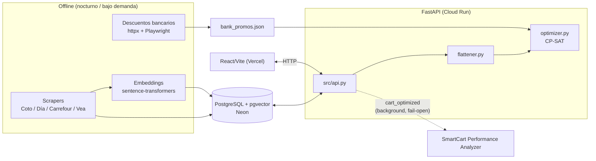

# Arquitectura de SmartCart

Cómo funciona SmartCart hoy, etapa por etapa. Dónde corre está en
[`operacion.md`](operacion.md); lo pendiente, en los
[issues](https://github.com/aviollaz/SmartCart/issues).

## 1. Qué resuelve

El mismo producto cuesta distinto en Coto, Día, Carrefour y Vea (la yerba puede
diferir 20-30%), y ninguna cadena gana en todo. SmartCart toma un carrito armado
en lenguaje natural y calcula cómo repartirlo entre las cuatro para gastar lo
mínimo, con las restricciones reales como duras: el mínimo de compra de cada
tienda, la cobertura de envío, y sólo los descuentos que el usuario declaró
(tarjetas, membresías).

Son dos problemas separados:

1. **Ingesta**, offline y nocturna: un catálogo unificado y al día de las
   cuatro cadenas.
2. **Optimización**, online, al apretar el botón: la combinación más barata
   para un carrito puntual.

## 2. Vista de alto nivel

| capa | tecnología |
|---|---|
| Base | PostgreSQL + `pgvector` (HNSW, coseno), en Neon |
| Backend | Python, FastAPI, `psycopg[binary,pool]`, Pydantic, `sentence-transformers` (`all-MiniLM-L6-v2`), OR-Tools CP-SAT |
| Scraping de catálogo | `httpx` contra las APIs internas: BFF REST de Coto, GraphQL de VTEX para Día, Carrefour y Vea |
| Descuentos bancarios | `httpx` (Coto, Vea) + Playwright/Chromium (Día, Carrefour) |
| Frontend | React 19, Vite, Tailwind v4, React Router, `react-leaflet` |
| Analítica | servicio aparte con su propia base, alimenta Power BI |

**No hay usuarios ni login.** El perfil (dirección, tarjetas, membresías) vive en
el `localStorage` y viaja en cada request. Eso ahorra tablas, sesiones y
backups, a cambio de que el historial no sobreviva a borrar los datos del
sitio ni pase a otro dispositivo.

## 3. El pipeline, etapa por etapa

### 3.1 Scraping (`src/scrapers/`)

Pide a cada sitio la misma API que usa para pintar su grilla; no hay scraping de
HTML.

- **Coto** (`scraper_coto.py`): BFF REST paginado.
- **Día, Carrefour y Vea**: VTEX, con una *persisted query* GraphQL de hash fijo
  que no admite campos nuevos. Un solo barrido, `VtexCatalogScraper`
  (`vtex.py`); cada tienda es una subclase registrada en `vtex_stores.py`.

**Entrada:** las claves de categoría de cada tienda, sacadas de `src/shelves.py`.
**Salida:** por producto, precio de lista, promos crudas, EAN, nombre, marca,
tamaño y stock, en un diccionario común.

Cada categoría termina bien o lanza `CategoryScrapeError`
(`src/scrapers/errors.py`). La distinción es lo que permite podar sin borrar
catálogo vivo (3.2).

**Vea** tuvo en oct-2026 un skimmer de tarjetas en las descripciones: estuvo
apagada y después deshabilitada por defecto, hasta que un muestreo de 1.551
productos no lo encontró más (13-nov). `clean_description()` guarda texto plano,
nunca HTML.

#### 3.1.1 Las góndolas (`src/shelves.py`)

La única taxonomía del proyecto. Cada fila es un slug canónico (`yerba-mate`),
una etiqueta, una sección del menú y las claves de esa góndola en cada tienda.
Hoy: **75 góndolas** en nueve secciones, con 141 claves de Coto, 109 de Día, 86
de Carrefour y 104 de Vea. Una góndola puede necesitar varias claves por tienda
porque cada taxonomía anida a otra profundidad.

Existe porque un producto sólo se compara entre cadenas si todas barrieron la
misma góndola. El slug decide, con una igualdad SQL:

- qué categorías barre cada tienda (`keys_for_store`),
- de qué góndola es un producto (`unified_products.shelf`),
- qué puede sustituir a qué (`substitutions.py`, `strategic_swaps.py`),
- qué dibuja el mega-menú (`GET /categories`).

Vea no cubre tres góndolas de protección femenina: su taxonomía mezcla
toallitas, protectores y tampones en una sola hoja. Pescadería y panadería
propia quedan afuera: se venden por peso con códigos internos y no unifican.

#### 3.1.2 Frescos emparejados a mano (`src/fresh_items.py`)

Frutas, verduras, carnes y pollo traen códigos de balanza (prefijo 20-29) que
cada cadena inventa: la misma manzana es `2000529000008` en Coto y
`2490039000000` en Día. `normalize_ean()` los descarta, así que sin esta tabla
cada fresco sería de una sola tienda.

La tabla declara qué SKU de cada cadena es el mismo producto y les da un
`unified_id = fresh_{slug}` común. La cura una persona con criterio estricto:
misma variedad y calidad, sin líneas premium, sin piezas de peso aproximado, un
SKU por tienda y al menos dos cadenas. `python -m src.scripts.curar_frescos`
propone candidatos por embedding y avisa qué SKUs desaparecieron. Los
embeddings sólo proponen: "ananá" queda más cerca de "nalga" que muchos pares
correctos entre sí.

### 3.2 Normalización y persistencia (`src/database.py`)

**Entrada:** los productos de una categoría. **Salida:** dos tablas.

- `unified_products`: una fila por EAN, compartida entre tiendas, con góndola,
  flags dietarios, tamaño normalizado y embedding.
- `store_products`: una fila por `(store_id, store_sku)`, la oferta de esa
  tienda: precio, stock, promos, URL y su propio nombre.

El esquema es DDL idempotente (`src/schema.py`); la base se repara sola al
conectar.

Transformaciones, cada una por un problema real de los datos:

- **EAN** (`src/ean.py`): Coto a veces publica el GTIN-14 del bulto; se deriva
  el EAN-13 sólo si el dígito verificador valida, y si no el producto queda sin
  unificar. Los códigos de 8 a 12 dígitos se dejan tal cual: todas las cadenas
  los truncan igual.
- **Tamaño** (`src/size_parser.py`): todo termina en `'g'`, `'ml'` o `'un'`. Lo
  que compara tamaños depende de que ese vocabulario no crezca.
- **Promos** (`src/promotion_parser.py`): cuatro tipos estándar,
  `direct_discount`, `conditional_discount_flat`, `conditional_discount` (2da al
  50%) y `multi_buy` (3x2). En Carrefour, la diferencia de precio suele ser el
  precio Mi Carrefour: queda marcada con `requires_membership`.
- **Flags dietarios** (`src/dietary_parser.py`): `TRUE` sólo ante una frase
  explícita ("sin TACC") en texto sobre ese producto, nunca en el marketing,
  que nombra productos hermanos. `FALSE` es "sin evidencia".

**Poda:** el guardado sólo hace upsert, así que lo que una tienda dejó de vender
quedaría para siempre. `prune_missing_store_products` borra lo que el barrido no
vio, sólo en las categorías que terminaron bien, y se aborta si el borrado
pasaría el 30%: eso indica un scraper roto, no un catálogo que cambió.

### 3.3 Embeddings (`src/embeddings.py`)

Codifica `"{brand} {name}"` con `all-MiniLM-L6-v2`, localmente, en
`name_embedding` (`vector(384)`, índice HNSW). Es una etapa aparte porque un
producto sin embedding no aparece en `GET /search`.

### 3.4 Logística (`src/coto_logistics.py`, `src/vtex_logistics.py`)

Antes de optimizar, se le pregunta a cada tienda si llega a la dirección y
cuánto cobra el envío, por endpoints públicos sin login: `getCobertura` en
Coto, el checkout de VTEX (`regions` + `orderForms/simulation`) en las demás.

- **Las cuatro se consultan en paralelo**: la etapa tarda lo que la más lenta,
  que suele ser Vea (2-6 s). Las respuestas válidas se cachean 30 minutos.
- **Coto** no expone el costo real sin sesión, y desde nov-2026 tampoco publica
  su tarifa: su envío sale del costo por zona, marcado como estimado.
- **Día** cobra por peso: después de optimizar se cotiza el carrito real de Día
  y, si sale más caro, se vuelve a optimizar (`_requote_dia_shipping`).

Es **fail-open**: si un endpoint falla, la tienda compite con el costo por zona.
Sólo un "no llegamos" explícito la excluye.

### 3.5 API (`src/api.py`)

FastAPI. Carga el modelo de embeddings una vez, al arrancar.

| endpoint | entrada | salida |
|---|---|---|
| `GET /search?q=` | texto + página y filtros | productos por relevancia, con bonus por disponibilidad |
| `GET /categories` | — | las góndolas por sección |
| `GET /category/{slug}` | slug + página y filtros | los productos de la góndola; 404 si no existe |
| `POST /products/by-ids` | hasta 100 `unified_id` | esos productos, en el mismo orden; un id ausente es un producto podado |
| `GET /deals` | límite, membresías, sección | los mayores descuentos del día |
| `GET /demo-cart` | — | un carrito de ejemplo con el catálogo del día |
| `GET /logistics/{tienda}/coverage` | coordenadas | si esa tienda llega |
| `POST /price-preview` | ítems + membresías | precio por tienda a esa cantidad |
| `POST /optimize` | carrito, dirección, tarjetas, membresías, tiendas deshabilitadas, días para comprar, tope de tiendas | el reparto óptimo, o 400 con el motivo |

**Listados** (`/search`, `/category`): devuelven una página de 48
(`{items, total, page, page_size, brands, price_bounds}`), y todos los filtros
se resuelven en el servidor (`_paginate_listing`). En el cliente no se puede:
el navegador sólo tiene una página, y mandar la góndola entera de `vinos` son
1.572 productos y ~13 s. Las facetas cuentan antes de filtrar por marca, para
que elegir una no borre las demás.

**Búsqueda:** trae los 100 vecinos más cercanos (lo único que acelera el índice
HNSW) y los reordena restando `0.01` por cada tienda extra, con tope de dos.
Calibrado contra el catálogo real: más bonus empieza a ordenar por cantidad de
tiendas en vez de por relevancia. Hay un modo híbrido (léxico + denso, por
Reciprocal Rank Fusion) apagado hasta medirlo (issue #24).

### 3.6 Optimización (`src/flattener.py`, `src/optimizer.py`)

1. **Aplanar** (`flatten_cart_prices`): para cada producto y tienda, el costo
   neto más barato a esa cantidad, con todas las promos que el usuario puede
   usar. Sale una matriz producto × tienda sin condicionales, lo único que ve el
   solver. Se calcula una vez por request, en paralelo con la logística.
2. **Optimizar** (`optimize_cart`): CP-SAT, una variable por (producto, tienda)
   y una por tienda activa. Minimiza `subtotal + envío − descuento bancario`
   sujeto a que cada producto se compre en una tienda que lo vende y a que cada
   tienda activa supere su mínimo de compra.

Con el reparto vienen: el ahorro contra el promedio de las otras tiendas
(`price_savings`, informativo, no comparable con el total), el costo de comprar
en menos tiendas (`fewer_stores_options`), reemplazos más baratos
(`suggestions`) y el cierre de tienda (3.7). Los candidatos para reemplazos y
cierre salen de una sola consulta (`CROSS JOIN LATERAL`), no de una por
producto.

Un carrito inviable devuelve 400 con la causa real: si un producto sólo lo vende
una tienda excluida, el mensaje lo dice, en vez de pedir "agregá más productos".

### 3.7 Cierre de tienda (`src/strategic_swaps.py`)

El solver es óptimo, pero no puede cambiar el carrito. Si un producto barato
sólo está en Carrefour, abre esa tienda y su mínimo arrastra el resto del
carrito ahí. La heurística busca, por tienda del reparto, los productos que sólo
ella vende, les busca reemplazo en la misma góndola (unidad compatible, peso
entre 0,5x y 2x) y vuelve a correr `optimize_cart` sin esa tienda. Una tienda sin
productos exclusivos se salta: cerrarla ya era una opción que el solver evaluó.

**Salida:** `strategic_swaps`, casi siempre vacía: "cambiá X por Y, sacá Z y
ahorrás $N".

### 3.8 Descuentos bancarios (`src/promotions/`, `src/bank_promos.py`)

Un pipeline aparte, bajo demanda, que lee los descuentos por tarjeta o
billetera de cada cadena y los guarda en `src/scrapers/bank_promos.json`, no en
Postgres: no cuelgan de ningún producto, son "toda la tienda, tal tarjeta, tal
día".

`load_bank_promos(día)` filtra por día de la semana antes del solver, que no
conoce el calendario. Si el archivo falta, no hay descuentos: inventar uno es
peor que omitirlo.

### 3.9 Analítica (`src/analytics.py`)

Cada `/optimize`, exitoso o inviable, manda un evento `cart_optimized` al
**SmartCart Performance Analyzer** (otro repo, otro servicio de Cloud Run, con su
base en el mismo proyecto de Neon), que alimenta Power BI.

Nunca puede romper ni frenar `/optimize`: va en un `BackgroundTask` con timeout
de 2 s y sólo loguea si falla. Por eso el caso inviable responde con
`JSONResponse` y no con `raise HTTPException`: FastAPI descarta las tareas en
background cuando el endpoint lanza, y se perdería justo el evento de "carrito
inviable".

### 3.10 Orquestación (`src/scripts/orchestrator.py`)

Envuelve el barrido de `run_scrapers.py` con lo que hace falta para correr sin
supervisión: logs a archivo con la fecha en el nombre, una fila de telemetría
por tienda en `scraper_execution_logs` (`SUCCESS`/`PARTIAL`/`FAILED`), chequeo
previo de la base y manejo de `SIGTERM`. Corre en GitHub Actions
([`operacion.md`](operacion.md)).

## 4. Frontend (`frontend/src`)

React 19, Vite, Tailwind v4 (tokens en `src/index.css`), React Router. Estado con
Context + `useReducer`/`useState` y `fetch` nativo sobre wrappers en `api/`: la
app no justifica una librería de estado.

El recorrido del usuario:

1. **Dirección** (`LocationModal.jsx`): geocodifica con Nominatim y deja
   seguir sin dirección si Nominatim está caído. Después pregunta las
   membresías, porque cambian los precios de la grilla desde el primer producto.
2. **Carrito**: por búsqueda, el mega-menú, el historial o el carrito de
   ejemplo. Guarda sólo `{unified_id: {name, quantity}}`; precio e imagen se
   piden al catálogo del día (`POST /products/by-ids`).
3. **Perfil** (`ProfileContext.jsx`): tarjetas, membresías y dirección. La zona
   de envío se deriva de la dirección, nunca se pregunta.
4. **Optimizar** (`/carrito`): el reparto por tienda, el ahorro, los avisos de
   cobertura y las sugerencias.

Cada optimización exitosa se guarda en el historial (`localStorage`). Dentro de
30 minutos reemplaza a la anterior, para no partir una compra en varias.

## 5. Tests

Muchos tests usan la app real y un Postgres poblado; el chequeo de CI corre
`pytest -m "not catalogo"`, que no los necesita.

- **Puros:** parsers, promos, optimizador con matrices fabricadas
  (`test_optimizer_correctness.py`, con un oráculo de fuerza bruta), orquestación.
- **Con base:** endpoints, búsqueda y ranking, poda, telemetría, esquema.

El backend se importa siempre como `src.<módulo>` (`pythonpath = .` en
`pytest.ini`).

## 6. Despliegue

| componente | dónde | por qué |
|---|---|---|
| Base | Neon, `aws-us-east-1` | escala a cero; el catálogo es derivado, así que no necesita backup |
| API | Cloud Run, `us-east1` | 413 MB de pico entran en el free tier; misma región que la base porque `/optimize` hace ~10 consultas en fila |
| Frontend | Vercel | se despliega en segundos, sin reconstruir la imagen de la API (~10 min con torch) |
| Barrido | GitHub Actions | sin costo |

Detalle y comandos en [`operacion.md`](operacion.md).
